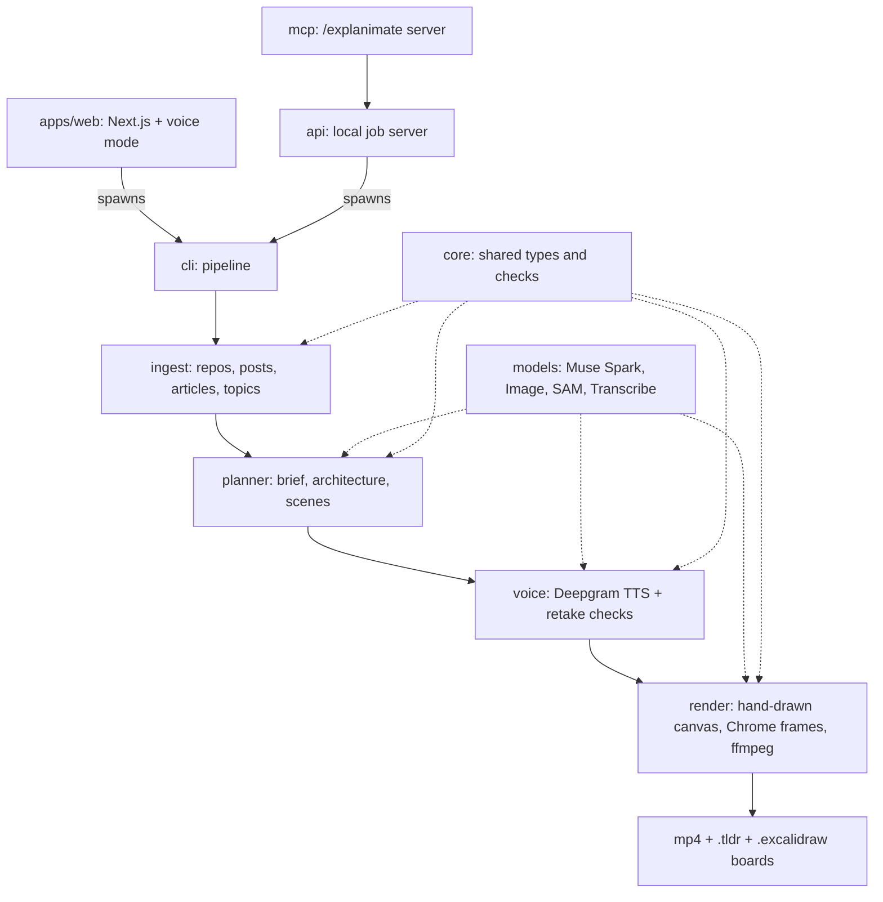

# Architecture

How Explanimate turns a link or a topic into a video, and where each step lives in the code. For setup, see the [README](../README.md).

## Pipeline

1. **Read.** It takes a digest of the repo (file tree, manifests, entry points, configs; secret files are never opened) or the article's text. A plain topic is looked up on Wikipedia, and the article plus up to two reputable pages it cites (standards bodies, universities, governments, major outlets) are read; every quote on screen comes from them, and the sources are named in the video, `sources.md` and the manifest.
2. **Plan.** Muse Spark maps the architecture, checks every box against real files, picks an approach and writes the scenes and narration.
3. **Voice.** Deepgram Aura reads the script (Cartesia Sonic when Deepgram fails and its key is set), and word timestamps let each box draw in on the word that names it.
4. **Draw.** The scenes become one hand-drawn SVG canvas with a moving camera. Skia draws the frames on a few threads and streams them into ffmpeg (NVENC when a GPU is there, else libx264). Set `EXPLANIMATE_RENDERER=chrome` to draw them in headless Chrome instead; Skia falls back to Chrome on its own if it cannot load.
5. **Check.** The frames and both boards are checked, and the voiceover is transcribed back and compared with the script.

The code is a pnpm workspace: `packages/` holds `core`, `models`, `ingest`, `planner`, `voice`, `render`, `cli`, `api` and `mcp`, and `apps/web` is the Next.js app. Icon packs are a plugin point; see [plugins.md](plugins.md). Run the tests with `pnpm test` and `pnpm typecheck`.

## Package map



## Where the Meta models are called

Explanimate calls Meta models through the Meta Model API (or Muse Spark through OpenRouter). See [`packages/models/src/index.ts`](../packages/models/src/index.ts).

- **`muse-spark-1.3` does the thinking**, always with strict structured JSON output validated by zod:
  - the brief: reads the source and picks the approach, depth, pace and look (`packages/planner/src/brief.ts`)
  - the architecture: extracts the parts and how they connect, then a review pass checks every box against real files and a fix pass repairs what failed (`packages/planner/src/architecture.ts`)
  - the scenes and narration, plus a plan check (`packages/planner/src/scenes.ts`)
  - follow-ups after a video: explaining a tapped box, a deep dive on it, and "what breaks at 10x traffic" (`packages/planner/src/followups.ts`)
  - voice mode on the web app, where Muse Spark holds the conversation and starts the video with a tool call (`apps/web/app/api/voice/turn/route.ts`)
  - an optional look at rendered frames to list layout problems (off by default, since it costs money)
- **`muse-image-1.0`** draws the doodle icons on the whiteboard.
- **`sam-3.1`** finds the drawn object so each icon is cropped cleanly.
- **`muse-voice-transcribe-1.0`** transcribes the finished voiceover and checks it says what the script says.

## What the videos contain

- **Repos** become a system design walkthrough on one canvas. It builds the architecture piece by piece, walks one real request through it, then circles what breaks at 10x traffic and draws the fix. Every box is tied to real files in the repo, and a second pass checks each box against the code before anything is drawn.
- **Articles and X posts** become an annotated view of the source, quotes underlined, followed by small concept boards. Every point carries a word-for-word quote from the source.
- **Nothing to configure.** Muse Spark reads the source first and picks how to explain it (an analogy, a story, step by step...), how deep to go, how fast and which look.
- **Checked before you see it.** Labels and arrows are checked against the camera before rendering, the finished frames are checked for cut-off words, overlaps and blank frames, and both boards are read back to make sure they open.

| A request, start to end                                                   | What breaks at 10x                                                             | The fix                                                               |
| ------------------------------------------------------------------------- | ------------------------------------------------------------------------------ | --------------------------------------------------------------------- |
|  |  |  |

## Output files

```bash
pnpm explanimate https://github.com/milind-soni/OpenMausBot
```

Every run prints what it spent. Results land in `explanimate-out/<name>/`:

- `<name>.mp4`: the 1920x1080 video, with narration and captions
- `<name>.tldr` and `<name>.excalidraw`: the drawing as boards you can keep editing
- `<name>.contact.jpg`: a sheet of frames for a quick look
- `manifest.json`: what was made, the check results and the spend

The plan and voiceover are cached in that folder, so running the same source again costs almost nothing. A GitHub repo's plan is also kept per commit in `~/.cache/explanimate/plans`, so a new folder for the same commit, asked the same way, skips the Muse planning calls too; a change to the planner code or a new commit plans again. Use `--fresh` to plan again, or set `EXPLANIMATE_PLAN_CACHE=0` to turn the shared cache off.

## Web app and voice mode

Paste a link and watch it build, with a live cost meter. Or press the **mic button** and just say what you want explained. The assistant talks back, asks what you want to understand and who it's for, then starts the video. You can interrupt it at any time, and a small box under the chat takes a typed link, since spoken names get misheard. Voice mode needs `DEEPGRAM_API_KEY`.

When the video is done you can tap any box for a short explanation from the code, render a 15-20 s deep dive on it, ask "what if 10x traffic?", or download the boards.

Every job spends your API credits. The web app has a per-IP rate limit, size limits and a spend guard that pauses new work before the Meta or Deepgram cap (`EXPLANIMATE_META_CAP_USD`, `EXPLANIMATE_VOICE_CAP_USD`). Voice mode only answers on localhost. Read [deploy.md](deploy.md) before you put it anywhere public.

If a server restart cuts a video off, it starts again on its own the next time the app loads. Every setting is listed in [`.env.example`](../.env.example).

## Model and voice fallbacks

Every setting is listed in [`.env.example`](../.env.example). Each AI service has a backup for when it fails:

- **Muse Spark** runs on Meta (`EXPLANIMATE_LLM_PROVIDER=meta`) or through OpenRouter (the default when `OPENROUTER_API_KEY` is set). When Meta is primary and a call fails after its retries, it is tried once on OpenRouter's `meta/muse-spark-1.3` if that key is set; otherwise the error surfaces.
- **Voice** is Deepgram Aura (`DEEPGRAM_API_KEY`); without it videos render silent. When Deepgram fails and `CARTESIA_API_KEY` is set, the scene falls back to Cartesia Sonic instead (`--voice cartesia` uses it directly; `CARTESIA_VOICE_ID` picks the voice).

`/api/health` reports `fallbacks: { llm, tts }`, so a deployment can see which backups are configured (booleans only, never keys).

## CLI

```
pnpm explanimate <github url | local repo folder | article url | x.com post url | "a topic"> [options]

  --out <dir>                 output folder (default ./explanimate-out/<name>)
  --voice <deepgram|cartesia|silent>   default: deepgram when DEEPGRAM_API_KEY is set
  --fresh                     plan again instead of using the cached plan
  --goal <text>               what you want to understand
  --audience <text>           who it is for
  --depth <overview|working|deep>
  --workers <n>               threads (Skia) or Chrome processes drawing frames
  --no-music, --no-qa         skip the music bed, skip the voiceover check
  --json                      progress as JSON lines
  --allow-private             read links that resolve to private or localhost addresses (local intranet only)

follow-ups on an earlier repo run:
  --from <earlier out dir> --focus <box id>       15-20 s deep dive on one box
  --from <earlier out dir> --what-if <10x|100x>   what breaks if traffic grows
```

`pnpm explanimate --help` lists the rest.

## Sample run


_12 seconds from a 2-minute video about [milind-soni/OpenMausBot](https://github.com/milind-soni/OpenMausBot). A run like this costs well under $0.20 in models and voice._
