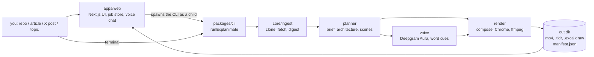

# How the code fits together

A guide for whoever picks this up next: what each package owns, how a run moves through them,
which checks can stop a video, and where it still breaks.

## The shape of it



The web app is a thin shell: it stores one JSON file per job on disk, spawns `node packages/cli/bin/explanimate.mjs`
as a child process, and polls that JSON. All the work is in the CLI and the packages under it.
Jobs need no database: each one is a JSON file. Accounts are the exception: when sign-in is on, users,
sessions and per-day usage live in Cloudflare D1, reached over its REST API (`lib/db.ts`). Up to `EXPLANIMATE_MAX_CONCURRENT` renders (default 10) run at once; past that, jobs wait
in a first-in, first-out line stored in `queue.json` next to the jobs, and their page shows the first step as starting soon.

## Packages

| Package            | Lines | What it owns                                                                                                                                                                                                                                                  |
| ------------------ | ----- | ------------------------------------------------------------------------------------------------------------------------------------------------------------------------------------------------------------------------------------------------------------- |
| `packages/cli`     | 1.2k  | `pipeline.ts` runs one video start to finish, in order, and writes `manifest.json`. `bin.ts` is the argument parser and progress emitter.                                                                                                                     |
| `packages/core`    | 2.5k  | Shared contracts (`ExplainSpec`, `ScenePlan`, `Architecture`, `Film`), the validators that read narration, HTTP and rate-limit helpers, the early private-link check, plan cache keys. No I/O beyond HTTP and git.                                            |
| `packages/planner` | 4.5k  | Four Muse calls that decide how to explain: `brief` picks analogy, depth, tempo, look; `architecture` finds the components and one request path; `scenes` writes the narration and the boards; `followups` makes the 15 s deep-dive and the what-if-10x clip. |
| `packages/voice`   | 0.5k  | Per-scene speech through Deepgram Aura (Cartesia Sonic when Deepgram fails), word timings, the respelling table for words Aura mispronounces, and the silent fallback when there is no key.                                                                   |
| `packages/render`  | 7.9k  | The picture: layout, drawing, camera, captions, music and sound effects, `.tldr`/`.excalidraw` writers, the placement and frame checks, and frames (Skia by default, Chrome fallback) into ffmpeg.                                                            |
| `packages/models`  | 0.4k  | One client for Muse Spark (on OpenRouter or Meta, picked by `llmProvider`; OpenRouter backs up Meta), Meta Muse image, SAM and Transcribe, and Deepgram, with the cost ledger and retries.                                                                    |
| `apps/web`         | 12.2k | The UI, the signed-in dashboard (`/app`) and sign-in, the job routes, the example gallery (`lib/gallery.ts`, read from `EXPLANIMATE_GALLERY_DIR`), the voice loop, the spend guard, rate limits, health.                                                      |
| `packages/ingest`  | 1.4k  | Reading the source: repo clone and digest, articles, X posts, topics and the pages they cite, the private-address guard and the secret-file filter.                                                                                                           |
| `packages/api`     | 0.5k  | The local job API on 127.0.0.1:7311 (`/v1/jobs`); it spawns the CLI for each job.                                                                                                                                                                             |
| `packages/mcp`     | 0.3k  | The MCP connector (`explain`, `explain_status`, `explain_cancel`) on top of the local job API.                                                                                                                                                                |

Line counts are approximate (source files only, tests excluded).

## Folder and file map

The repo is a pnpm monorepo: one repo holding several packages that share code. `packages/` holds the engine, and `apps/web` is the website.

```
explanimate/
├── AGENTS.md                 contributor and coding-agent guide: start here
├── README.md                 public intro and quick start
├── .env.example              every setting, with what it does (no values)
├── package.json, pnpm-*.yaml workspace setup and shortcut commands (pnpm explanimate, pnpm web)
│
├── apps/web/                 ── WEB APP (Next.js, a React web framework)
│   ├── app/page.tsx          home page: paste a link, or press the mic
│   ├── app/gallery/page.tsx  /gallery: finished example videos
│   ├── components/           screens: Home, InputScreen, Steps (progress), Player, ResultView, VoiceMode, GalleryGrid, Nav, SignIn
│   ├── app/api/jobs/...      start a video, check progress, fetch files, explain a box, follow-up clips
│   ├── app/api/voice/...     voice-mode chat: speak, listen, take a turn (localhost only)
│   ├── app/api/health        says whether the machine can make a video right now
│   ├── app/app/...             /app: the signed-in dashboard (overview, editor, videos, connect, usage, settings)
│   ├── app/api/me/...          the account's videos (list, delete) and account deletion
│   ├── lib/videos.ts           one account's videos joined with live jobs, ownership-checked deletes
│   ├── lib/jobs.ts           the job store and the silent queue (one JSON file per job)
│   ├── lib/guard.ts          spend guard: pauses new work before a spend cap is crossed
│   ├── lib/serve.ts, validate.ts, reach.ts   rate limits, input checks, private-address blocking
│   ├── lib/gallery.ts        reads the gallery folder and its gallery.json
│   ├── lib/steps.ts          the progress-list wording for each stage
│   └── test/                 web tests (queue, guard, gallery, voice...) with a fake CLI
│
├── packages/cli/             ── THE ENGINE'S FRONT DOOR
│   ├── src/bin.ts            `pnpm explanimate <link or topic>` and its flags (--out, --fresh, --no-qa)
│   └── src/pipeline.ts       runs every stage in order and writes manifest.json
│
├── packages/ingest/          ── READING THE SOURCE
│   ├── src/repo.ts           clones a repo at a fixed commit and builds a digest
│   ├── src/topic.ts, concept.ts   topics, articles and X posts, and the pages they cite
│   ├── src/net.ts            safe fetching: size limits, timeouts, private-address guard
│   └── src/secrets.ts        never opens files that look like secrets
│
├── packages/planner/         ── DECIDING WHAT TO SAY
│   ├── src/brief.ts          picks the approach, depth, tempo and look
│   ├── src/architecture.ts   maps the parts and connections, plus the review pass
│   ├── src/scenes.ts         writes the script and runs the self-checks and rewrites
│   ├── src/beats.ts          one visual per narration line, and the check that the words match
│   ├── src/shapes.ts         story shapes (journey, problem then fix...)
│   └── src/followups.ts      15-second deep dives and "what if 10x traffic?" clips
│
├── packages/models/          ── TALKING TO THE AI
│   └── src/index.ts          Muse Spark via OpenRouter or Meta (Meta falls back to OpenRouter), plus image, SAM and Transcribe; costs, retries, raced calls
│
├── packages/voice/           ── THE VOICEOVER
│   └── src/index.ts          Deepgram Aura speech with word timings (Cartesia backup), a fix-up table for misread words, a silent fallback
│
├── packages/core/            ── SHARED RULES AND SHAPES
│   ├── src/schemas.ts        the data shapes: Scene, Beat, visual types
│   ├── src/plain.ts, text.ts the plain-language and grammar rules
│   ├── src/llm.ts, env.ts    picks the AI provider and reads settings (old names too)
│   ├── src/walk.ts, figures.ts, places.ts   walkthrough matching, numbers, map places
│   └── data/naturalearth.json   world map outlines for history and geography topics
│
├── packages/render/          ── DRAWING THE VIDEO
│   ├── src/layout.ts, placement.ts   where boxes go, and the check that nothing is cut off
│   ├── src/cards.ts          full-screen line cards (kinetic words, chips, terminal, contrast...)
│   ├── src/compose.ts, film.ts, pace.ts   turn the plan into a timed film, camera moves and pacing
│   ├── src/skia.ts, skia/    the fast frame drawer (Skia, a 2D graphics library) on worker threads
│   ├── src/capture.ts, stage/   the Chrome renderer, kept as the backup
│   ├── src/renderer.ts       picks Skia or Chrome, and the video encoder
│   ├── src/framecheck.ts, check.ts, boardcheck.ts   check frames, captions and boards after drawing
│   ├── src/tldraw.ts, excalidraw.ts   EXPORTS: write the .tldr and .excalidraw boards
│   ├── src/music.ts          background music and sound effects
│   ├── packs/doodle/         about 40 hand-drawn icons (database, server, robot...)
│   └── assets/fonts/         hand-drawn fonts (Excalifont, Shantell Sans, Nunito)
│
├── packages/api/             ── LOCAL JOB API on port 7311 (/v1/jobs), used by the connector
├── packages/mcp/             ── MCP CONNECTOR: lets an AI coding tool call Explanimate
│   └── src/server.ts         tools explain / explain_status / explain_cancel, plus the /explanimate command
│
├── examples/packs/supabase/  sample icon pack (see docs/plugins.md)
├── scripts/                  check-secrets.sh (pre-commit secret scan), gen-icon-pack.ts, set-user-limit.ts, loadtest.mjs
├── Dockerfile, .dockerignore DOCKER: one image with Node, Chromium, ffmpeg, git; data on a /data volume
├── .github/workflows/ci.yml  CI: lint, format, typecheck, tests, web build and browser tests on every push and PR
├── .github/workflows/deploy.yml  deploys main after green CI, off until DEPLOY_ENABLED is set (see docs/deploy.md)
├── e2e/                      Playwright browser tests with a stand-in pipeline (no keys, no cost)
│
└── docs/
    ├── code-map.md           this file: how the code fits together
    ├── explaining-playbook.md   the engine's script rules
    ├── deploy.md             how to run it on a server
    ├── plugins.md            how icon packs work
    ├── gallery.example.json  the format of the gallery list
    ├── design/landing-v2/    the landing page reference mockup
    ├── media/                readme images and sample frames
    └── research/             study notes behind the narration rules (PLAYBOOK.md)
```

Tests sit in each package's `test/` folder and use Node's built-in test runner. Run them with `pnpm test`.

## A run, hop by hop

1. **Ingest.** A GitHub URL is cloned at a pinned commit and digested into a file tree plus excerpts; an
   article or X post is fetched and cleaned; a topic is read from Wikipedia and the pages it cites.
2. **Brief.** Muse picks the analogy, the audience, the depth and the tempo, and the engine overrides two
   of those decisions: a repo is always a whiteboard, and what the viewer asked for wins.
3. **Architecture.** Muse names 3 to 8 components, each backed by real file paths, then draws one request
   path through them. A validator drops components whose evidence does not exist, a reviewer re-reads it,
   and a fix pass applies the reviewer's patches.
4. **Scenes.** Muse writes the narration scene by scene, with the heading, the board nodes and the exact
   phrases the drawing will sync to. The plan is then polished for speech, renamed to plain keywords,
   self-checked, and repaired. A structural problem replans once, and a wording problem gets a small rewrite and a second look, up to two rounds.
5. **Compose.** The plan becomes a `Film`: element positions and start times, camera keys, captions with
   per-word timings, headings, fades. No pixels yet.
6. **Voice.** Each scene is spoken, 8 at a time, and cut to word timings; the narration is mixed to one
   24 kHz track at the timeline offsets.
7. **Placement.** The film is checked against its own geometry: 7 rules, up to 8 fix passes, then a
   fallback pass that may widen the shot past the readable size.
8. **Boards.** `.tldr` and `.excalidraw` are written, read back, and compared to the sketch.
9. **Frames.** Skia draws each 1080p frame on a few threads (headless Chrome is the fallback), into a
   queue that ffmpeg is already encoding from stdin.
10. **Frame check.** A fresh Chrome seeks the same stage, asks where every element actually landed, and
    decodes the written JPEGs to catch blank frames.
11. **Manifest.** Stage timings, every check result, the cost ledger, and the duration.

## Checks: what can stop a run

| Check                                | Where                         | If it fails                                                             |
| ------------------------------------ | ----------------------------- | ----------------------------------------------------------------------- |
| architecture evidence                | `planner/src/architecture.ts` | components are dropped and the reviewer's patches applied; never silent |
| scene self-check                     | `planner/src/scenes.ts`       | structural → replan once; wording → one targeted rewrite                |
| speech (articles, agreement, filler) | `core` + `planner`            | the same targeted rewrite                                               |
| placement                            | `render/src/placement.ts`     | **throws**: no video                                                    |
| captions match narration             | `render/src/check.ts`         | **throws**                                                              |
| board read-back                      | `render/src/boardcheck.ts`    | **throws**                                                              |
| frame check                          | `render/src/framecheck.ts`    | recorded in `manifest.json` and the notes only                          |
| pace (cut rate, holds)               | `render/src/pace.ts`          | recorded only                                                           |
| voice QA (Muse Transcribe)           | `cli/src/pipeline.ts`         | recorded only                                                           |

So "nothing ships unchecked" is true, and "nothing ships broken" is not: a film whose frames slipped
past the placement model still encodes, with the problem written into the manifest. That is a deliberate
trade: a late frame issue should not throw away six minutes of drawing, but it means the manifest is
the place to look, not the exit code.

## Money and time, measured

A full run of `karpathy/minbpe` on a laptop, everything already cached (plan and voice hit,
so `$0.00` of model spend):

| Stage                                  | Seconds                |
| -------------------------------------- | ---------------------- |
| ingest                                 | 0.3                    |
| brief, architecture, scene plan, voice | 0 (cache)              |
| compose                                | 2.1                    |
| draw 7,643 frames                      | 333                    |
| frame check                            | 28.7                   |
| encode tail + contact sheet            | 11.2                   |
| **total**                              | **383** (a 4:14 video) |

Frames draw at roughly 20 per second with the default worker count, so the wall clock is about 1.4×
the video length. Planning is the cheap part; the drawing is the cost in time. Model spend on a fresh
run of this size is a few cents of Spark plus a few cents of Aura.

The spend guard caps Meta at `$25` and Deepgram at `$10`, warns at 80%, and pauses new work rather than
overspending. Cached re-runs are genuinely free: `$0.000` on the run above.

## Outside services (setting names only, never values)

| Service                                                 | Used for                                                                                                                                                                           | Setting              |
| ------------------------------------------------------- | ---------------------------------------------------------------------------------------------------------------------------------------------------------------------------------- | -------------------- |
| **OpenRouter → Muse Spark 1.3** (`meta/muse-spark-1.3`) | all planning and script writing, plus voice-mode chat. The default when its key is set, and the backup when Meta is primary.                                                       | `OPENROUTER_API_KEY` |
| **Meta Model API**                                      | Muse Spark on Meta's own API (`muse-spark-1.3-contributor`), doodle icons (Muse Image + SAM, which cuts an image out of its background), and the voiceover check (Muse Transcribe) | `MODEL_API_KEY`      |
| **Deepgram**                                            | Aura voice (`aura-2-arcas-en` for videos, `aura-2-thalia-en` for chat), Nova-3 speech-to-text in voice mode                                                                        | `DEEPGRAM_API_KEY`   |
| **Cartesia**                                            | Sonic voice when Deepgram fails, with word timings estimated at speaking pace                                                                                                      | `CARTESIA_API_KEY`   |

With no Deepgram key, videos render silent with timed captions. When Deepgram fails and a Cartesia key is set, the narration falls back to Cartesia Sonic. Keys live in a gitignored `.env` or `apps/web/.env.local`.

## Key settings

| Setting                                               | What it does                                                                                          | Default                         |
| ----------------------------------------------------- | ----------------------------------------------------------------------------------------------------- | ------------------------------- |
| `EXPLANIMATE_LLM_PROVIDER`                            | force `openrouter` or `meta` for Muse Spark                                                           | OpenRouter if its key is set    |
| `EXPLANIMATE_SPARK_MODEL`                             | a different model name                                                                                | per provider                    |
| `EXPLANIMATE_HEDGE`                                   | how many copies of long AI calls to race, keeping the first answer                                    | 2                               |
| `EXPLANIMATE_RENDERER`                                | `skia` or `chrome`                                                                                    | skia                            |
| `EXPLANIMATE_ENCODER`                                 | `nvenc` (graphics card) or `x264`                                                                     | auto                            |
| `EXPLANIMATE_VOICE` / `_CHAT_VOICE` / `_STT`          | the video voice, chat voice and listening model                                                       | arcas / thalia / nova-3         |
| `EXPLANIMATE_META_CAP_USD` / `_VOICE_CAP_USD`         | spend caps; new work pauses before crossing them, with a warning at 80%                               | 25 / 10                         |
| `EXPLANIMATE_META_RESERVE_USD` / `_VOICE_RESERVE_USD` | room kept free for one more job                                                                       | 1 / 0.15                        |
| `EXPLANIMATE_REQ_PER_MIN` / `_JOBS_PER_HOUR`          | rate limits: per visitor, and for everyone combined                                                   | 12 / 20                         |
| `EXPLANIMATE_MAX_CONCURRENT`                          | videos rendering at once; the rest wait in line (`EXPLANIMATE_CONCURRENCY` still works)               | 10                              |
| `EXPLANIMATE_QUEUE_MAX`                               | most videos allowed to wait                                                                           | 200                             |
| `EXPLANIMATE_WAIT_IDLE_S`                             | drop a waiting video this many seconds after its tab closes                                           | 120                             |
| `EXPLANIMATE_DEMO_ONLY`                               | 1 = show the gallery only, refuse new videos                                                          | 0                               |
| `EXPLANIMATE_RESUME`                                  | restart jobs that a crash cut off                                                                     | 1                               |
| `EXPLANIMATE_TRUST_PROXY`                             | trust the visitor address from a proxy in front                                                       | 0                               |
| `EXPLANIMATE_ALLOW_PRIVATE_URLS`                      | allow links to private network addresses (refused everywhere by default; 1 only for a local intranet) | 0                               |
| `EXPLANIMATE_JOBS_DIR` / `_GALLERY_DIR` / `_OUT_DIR`  | where jobs, gallery videos and CLI output go                                                          | repo folders, `/data` in Docker |
| `EXPLANIMATE_PLAN_CACHE`                              | 0 turns off the shared plan cache                                                                     | on                              |
| `EXPLANIMATE_CHROME`                                  | Chrome path if it's not in a standard place                                                           | auto-found                      |
| `EXPLANIMATE_API_PORT` / `_MCP_WAIT_SEC`              | local API port, and how long the connector waits per call                                             | 7311 / 50                       |

The full list is in `.env.example`.

## Where it can still bite you

**1. The render is the clock.**
Renders past `EXPLANIMATE_MAX_CONCURRENT` wait for a slot (`pump` in `apps/web/lib/jobs.ts`); the line is
stored on disk, so a restart picks it back up instead of failing it. With frames at ~20/s, a four-minute video
is a six-minute wait, longer when several draw at once on the same CPU.
A live "watch it make one" beat cannot fit in a three-minute demo; and the "30 second cached re-render"
in the older docs is wrong. The cache skips planning and voice (`0 s, $0.00`), then every frame is
redrawn, because the frames folder is deleted at the start of each run (`packages/cli/src/pipeline.ts:310`).

**2. A result opens paused on a still.**
Browsers block unmuted autoplay without a gesture. `Player` catches the rejection, seeks to 55% and
leaves it paused (`apps/web/components/Player.tsx:30-32`), so a link opened cold (`/?job=<id>`)
looks like a frozen frame with no narration. Enter through the form or the mic so a
click has happened, or click play once before the reveal.

**3. Voice mode has three doors, and all must be open.**
Microphone permission must be granted in the browser profile used for the demo; the three voice routes
refuse anything that is not loopback (`apps/web/lib/local.ts:10-14`), so a tunnel or a phone on the LAN
gets `voice mode only runs on localhost`; and under `next dev` the first `POST /api/voice/turn` pays a
cold compile, which reads as "Thinking…" hanging. Pre-warm it, or run `next build && next start`.

## Running it

- **Web:** `pnpm web`, keys in `apps/web/.env.local`; Next loads that file itself.
- **CLI:** `pnpm explanimate <url>`, keys in a `.env` or `.env.local` in the working directory
  (`packages/cli/src/bin.ts:7-13`). The CLI does not read `apps/web/.env.local`, so a fresh clone needs
  its own file at the root.
- **Tests:** `pnpm test` (node:test, includes a synthetic render through Skia with a Chrome fallback).

## Two warts worth knowing

- The private-address guard is on for the web app (`apps/web/lib/jobs.ts` passes
  `EXPLANIMATE_ALLOW_PRIVATE_URLS=0`), and the local API, the MCP connector and the CLI refuse
  localhost and private-network links by default too. `EXPLANIMATE_ALLOW_PRIVATE_URLS=1` (or the CLI's
  `--allow-private`) lifts it for local intranet pages only; keep it off in anything that takes links from strangers.
- Chrome is looked for in three places (`packages/render/src/capture.ts`, `packages/ingest/src/concept.ts`,
  `apps/web/lib/health.ts`). All three now know the Windows folders, but the lists can drift again; if one
  starts a video and another reports the machine unhealthy, this is why.
